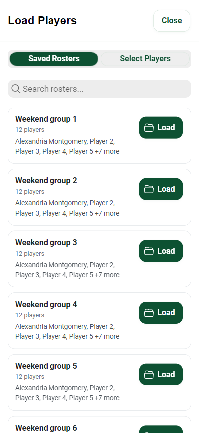
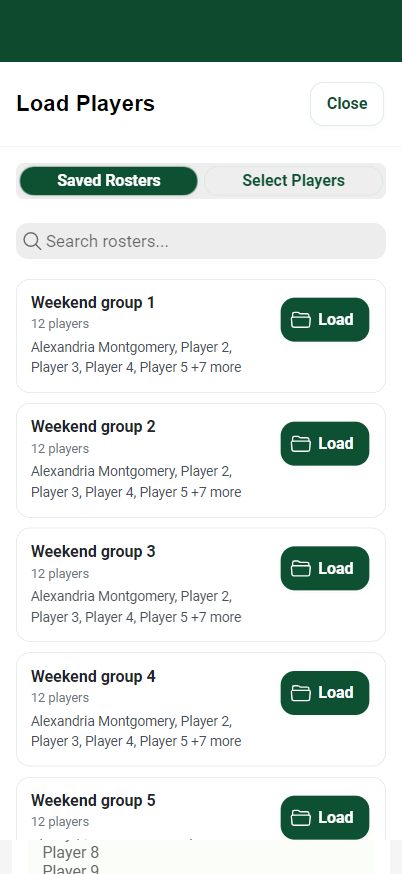

# 1.4.1 release preparation

Reviewed upstream/fork master `1085a2f` on 2026-10-28. Branch: `fix/release-1.4.1-ios-ux`.
This is a maintenance release. No gameplay, OCR, persistence, navigation or update-service logic changed.

## Modal defect and correction

Load Players used a component-scoped `--height: 100%` override on narrow screens. It defeated the shared safe-area-aware height. The plain header had no top safe-area protection, putting Close at about y=20 in the reproduced layout. Centering a smaller modal alone also does not correctly distribute unequal top and bottom safe-area insets.

The shared overlay now occupies the safe rectangle inside the visual viewport. Its content sizes relative to that rectangle. Component sizing overrides are removed from PlayerRosterSelector; existing header/footer safe padding is not applied twice. The existing visualViewport listener still handles keyboard resizing and ignores pinch zoom. Toast clearance remains intact.

At 402×874 with synthetic 62px top / 34px bottom insets, the modal now occupies y=62–840 and Close occupies y=82–126 (44px high).

| Before | After |
| --- | --- |
|  |  |

These are real application screenshots in Chromium with synthetic safe-area values, **not native iPhone screenshots**. No status bar or Dynamic Island artwork was fabricated.

## Changed files

- `package.json`, `package-lock.json`: app metadata 1.4.1; dependency versions unchanged. The lockfile's previous app version was stale at 1.3.0.
- `ios/App/App.xcodeproj/project.pbxproj`: both marketing versions 1.4.1; checked-in build number 2 unchanged.
- `android/app/build.gradle`: versionName 1.4.1; checked-in versionCode 1 unchanged.
- `src/components/PlayerRosterSelector.vue`: remove conflicting modal sizing rules only.
- `src/services/overlayLayout.css`: shared safe-area/visual-viewport bounds and avoid duplicate internal insets.
- `.github/workflows/ios-build.yml`, `.github/workflows/android-build.yml`: automatic validated GitHub workflow run numbers; no dispatch parameter required; signing, targets and upload conditions unchanged.
- `scripts/validate-build-number.mjs`, `tests/build-number.test.mjs`: validate automatic release build numbers before signing/build steps.
- `tests/release-version.test.mjs`: verify package, lockfile and both native marketing versions agree.
- `scripts/check-overlay-layout.cjs`: browser geometry, resize, dismissal, navigation and preservation checks with screenshots.
- This report and two evidence screenshots.

## Versions and build numbering

Package, lockfile, iOS MARKETING_VERSION (CFBundleShortVersionString), Android versionName and About resolve to **1.4.1**. Application identifiers remain `com.pickleballteamflow.app`. `android-production-release.json` is unchanged (`release: null`).

Store history checked 2026-10-28:

- App Store production 1.4.0 / build 71; TestFlight and recent uploads top out at 71. No 1.4.1 binary exists yet.
- Google Play highest uploaded code 21 (testing); production uses 20, version 1.4.0.

Build numbers come automatically from `github.run_number`; Run workflow has no build-number field. Run release builds in `marco-rodriguez59/pickleballteamflow` to continue the original per-workflow counters (last verified uploads: iOS 71 and Android 21). The historical-floor check prevents a fresh fork counter from uploading a lower number. This is not a live store query. Use a new workflow dispatch after a successful upload rather than rerunning that same run, because reruns retain their run number. Local native builds still require suitable build numbers before uploading.

The workflows remain manual. Their existing master-branch upload steps can upload to TestFlight or Play **beta**; no workflow was dispatched for this task. The existing beta track differs from the latest commit's wording about internal testing and was intentionally preserved.

## Validation

Validation completed: **117/117 tests passed**, **14/14 browser configurations passed**, and **production build passed**.

Run the existing suite with `npm test` and build with `npm run build`.
The build retains the existing large-bundle warning; there are no compile errors.

Browser audit: run `npm run dev -- --host 127.0.0.1 --port 4223 --strictPort`, then `node scripts/check-overlay-layout.cjs` with Playwright available in NODE_PATH. No dependency was added to the app. The harness uses installed Microsoft Edge. `AUDIT_URL` overrides the preview URL, `AUDIT_OUTPUT` sets the evidence directory, and `AUDIT_CASE` selects a case. `AUDIT_BASELINE=1` captures the original geometry without asserting the fix.

| Representative configuration | CSS viewport | Synthetic insets top/bottom/sides | Root font |
| --- | --- | --- | --- |
| iPhone 17 Pro | 402×874 | 62/34/0 | 16px |
| iPhone 17 Pro Max | 440×956 | 62/34/0 | 16px |
| Small iPhone | 375×667 | 20/0/0 | 16px |
| Other Dynamic Island phone | 393×852 | 59/34/0 | 16px |
| iPhone landscape | 874×402 | 0/21/62 | 16px |
| iPad portrait | 768×1024 | 24/20/0 | 16px |
| iPad landscape | 1024×768 | 24/20/0 | 16px |
| Small Android | 360×640 | 24/24/0 | 16px |
| Android cutout | 412×915 | 40/24/0 | 16px |
| Android tablet | 800×1280 | 24/24/0 | 16px |
| Narrow web | 320×568 | 0/0/0 | 16px |
| Desktop web | 1440×900 | 0/0/0 | 16px |
| Large text | 402×874 | 62/34/0 | 32px (200%) |
| Reduced keyboard-height area | 402×400 | 62/0/0 | 16px |

All cases check Load Players bounds, Close visibility/touch height, long-library scrolling, bottom selection actions, cancellation without storage changes, Players/Settings/Help navigation and About version. The iPhone case also resizes an open modal through tablet/keyboard-height/phone sizes. iPhone, iPad portrait and large-text cases additionally exercise roster editing/player picker cancellation, cancelled deletion, Save Roster cancellation, generation, round completion, Swap dismissal, and actual optional-update prompt dismissal without store access. Saved library/working roster and open/completed round state are checked for preservation.

## Audit scope and remaining device QA

Reviewed Home/setup/assignments/completed rounds, Players & Rosters, picker/load/save/create/edit UI, swap, shared modal/alert styling, settings, Help, notification styling, photo input and optional-update prompt. No algorithms, badges, colors or app action handlers were changed.

Browser screenshots show generated-success feedback above the swap modal's bottom edge. Existing preview-name truncation in roster cards and some busy wrapping at very large text were retained; the full player selection names remain available. Existing blue/green theme rules were not redesigned. Camera access/OCR processing and native store update execution were not exercised or changed.

Windows has no iOS simulator available here. Native WebKit safe-area reporting, Dynamic Type/Bold Text, VoiceOver/TalkBack, real keyboard panning, Android edge-to-edge and OS camera sheets remain device checks. Source-reviewed legacy settings/rating modals were not forced open through private component state. Do not treat browser coverage as native certification or claim zero possible regressions.

After the PR is reviewed, build 1.4.1 and verify on the reported iPhone 17 Pro: Load Players → Close, rotation while open, search keyboard, large text, player picker, swap with/without sit-outs and complete-round scrolling. Repeat on iPad and an Android cutout device before submission.

## App Store Connect (separate from the code fix)

User explicitly approved creation of the 1.4.1 record. It is **Prepare for Submission**, with no binary attached; this does not create a TestFlight build.

Saved in English (U.S.): approved promotional text (165/170 characters) on production and draft, subtitle `Round Robin Court Organizer` (27/30), approved keyword list (96/100), and release notes narrowed to the implemented modal fix. App name unchanged.

Release notes:

> We've made Pickleball Team Flow even smoother!
>
> • Fixed roster-selection modal controls that could overlap the status bar on iPhones with display cutouts.
> • Improved modal sizing across phones, tablets, and different screen sizes, including larger text and smaller viewing areas.

Reviewed category (Sports / Utilities), age rating (4+), privacy disclosure (Data Not Collected), privacy URL `https://pickleballteamflow.app/app.html#/privacy`, support URL `https://pickleballteamflow.app/app.html#/support`, description and reviewer instructions. They broadly match current local-only features. Description retains literal Markdown heading markers; cleanup would need separate approval. No editable App Store Tags control was found in the reviewed sections; no tags changed.

Accessibility declarations have not been configured. Do not claim support until native assistive-technology testing is complete. No new blocking agreement was shown on the reviewed app pages; account-wide legal status was not altered. A newer marketing-assets notice is informational, not evidence of a mandatory screenshot replacement. The existing header asset remains; approved screenshots were not deleted/replaced, and the full screenshot gallery still needs final review after attaching the build. Verify reviewer contact fields and export-compliance answers when attaching the binary. Existing automatic-release-after-approval setting was not changed; review that setting before any future submission.

No app submission, release, pricing/availability change, legal acceptance, merge, native build or upload was performed. Remaining release steps: review/merge PR with approval, run native builds from the original repository, test the reported device, attach the binary, review screenshots/contact/compliance and release mode, then obtain explicit submission/release approval.
